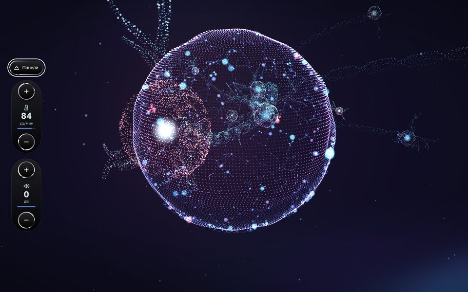
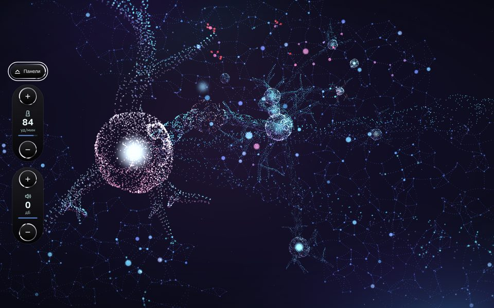
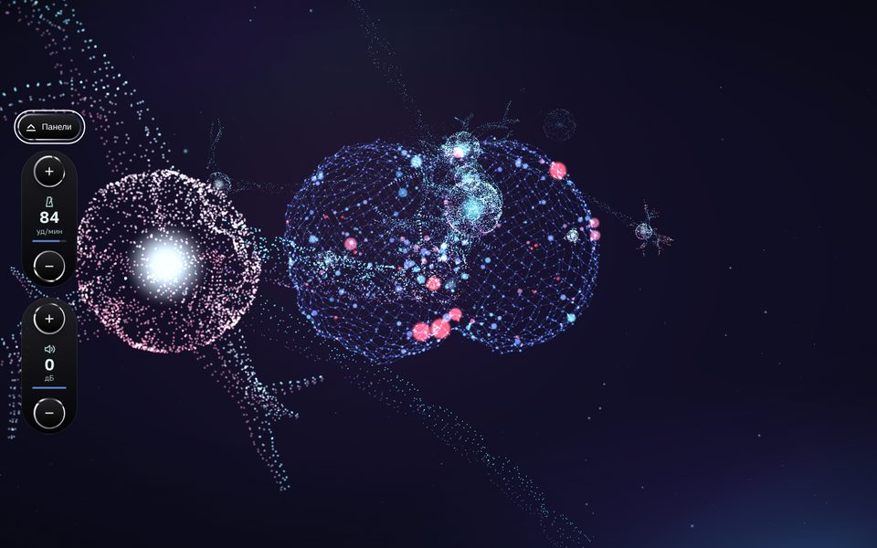
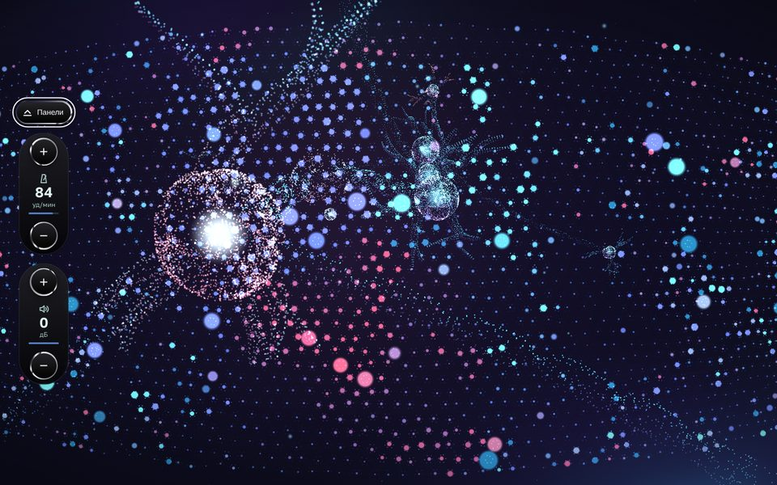
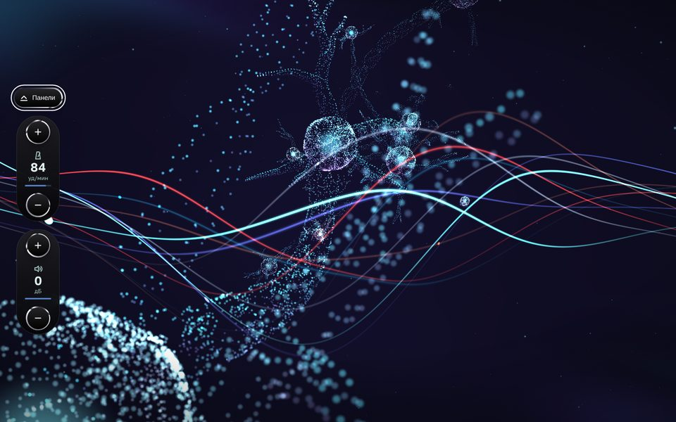

# Нейросинт

Браузерный грувбокс для спокойного сета. Шесть лупов, четыре части, которые сбавляют темп и яркость, и 3D-нейроны, которые светятся вместе со звуком. Tone.js и Three.js, без сборки.


Демо: https://digitalsecretaryalex-prog.github.io/WebsintAlex/

## Запуск

Нужен локальный сервер и доступ к CDN (Tone.js, Three.js, шейдеры металла, шрифт).

```bash
git clone https://github.com/digitalsecretaryalex-prog/WebsintAlex.git
cd WebsintAlex
python3 -m http.server 8000
```

Открыть http://localhost:8000 и нажать круглую кнопку слева сверху. Звук стартует только по клику.

Выбор хранится в адресе, ссылка открывает то же самое:

| Параметр | Значения | По умолчанию |
| --- | --- | --- |
| `?view=` | `flight`, `stream`, `field`, `cascade`, `tunnel`, `wave` | `tunnel` |
| `?bg=` | `membrane`, `cortex`, `brain`, `sync`, `plasma`, `dust` | `membrane` |
| `?ui=` | `liquid`, `glass`, `metal`, `base` | `liquid` |

## Как играть

|  | Мышь | Клавиши |
| --- | --- | --- |
| Старт / стоп | кнопка слева сверху | `Space` |
| Слой | кнопка слоя | `1`-`6` |
| Вариация слоя | три точки под кнопкой | `Q` `W` `E` `R` `T` `Y` |
| Часть сета | кнопки сверху | `Z` `X` `C` `V` |
| Сброс части | круг справа сверху | `0` |
| Виды и фоны | кнопка под стартом |  |
| Скрыть панели | кнопка под ней, вернуть: «Панели» слева | `H` |
| Ракурс нейронов | тянуть по экрану, правая кнопка или Shift сдвигает, колесо приближает |  |
| Ручки и движки | тянуть, двойной клик сбрасывает | стрелки, `PageUp`, `PageDown`, `Home`, `End` |

Смены слоёв, вариаций и частей звучат с начала следующего такта. Когда панели скрыты, слева остаются темп (шаг 1 уд/мин) и общая громкость (шаг 2 дБ).

Сет из четырёх частей:

| Часть | Темп | Что меняется                                            |
| ----- | ---- | ------------------------------------------------------- |
| 1     | 84   | бочка, перкуссия, бас, пэд, фон                         |
| 2     | 79   | входит мелодия                                          |
| 3     | 74   | уходит бочка, общий фильтр прикрыт на 25 %              |
| 4     | 70   | редкая бочка, без перкуссии, фильтр −45 %, мастер −3 дБ |

## Звук

```
источник → Filter → FeedbackDelay → Reverb → Channel ─┐ ×6
                                                       └→ lowpass → highpass → FeedbackDelay → Volume → Channel → Limiter → выход
```

У каждого слоя ручки тона (фильтр), эха, простора (реверб) и панорамы, движок громкости и Mute. На выходе DJ-фильтр (влево срезает верха, вправо низы), общее эхо и громкость. Рядом с темпом свинг шестнадцатых.

- Звук без DOM: `audio.js` строит граф и транспорт, интерфейс звук не создаёт.
- Граница такта считается в тиках транспорта: `'@1m'` считает в секундах и после плавной смены темпа промахивается.
- Пэд на `fatsawtooth`: осциллятор `pwm` в Tone.js строится на WaveShaper и давал алиасинг, слышный как хрип. Контекст с `latencyHint: 'playback'`, буфер больше, звук не рвётся под нагрузкой 3D.
- Моно-синт не запускается дважды в одно время: под тяжёлой графикой Tone изредка отдаёт шаг дважды, и синт падал с ошибкой.

## Свет под звук

Каждая нота приходит в картинку событием с громкостью, высотой и длиной (`audio.js: notify`). Событие ждёт, пока звук дойдёт до колонок (время ноты плюс `baseLatency` и `outputLatency`), поэтому вспышка совпадает с ударом.

Все ручки слоя видны в свете одинаково во всех видах и фонах (`src/backgrounds/hearing.js`):

| Ручка | Что видно |
| --- | --- |
| тон (фильтр) | закрытый даёт тусклую вспышку, открытый яркую |
| эхо, обратная связь | вспышка повторяется через пунктирную восьмую, до трёх раз |
| простор (реверб) | свечение тает дольше |
| панорама | вспышка на своей стороне экрана |
| громкость, слой включён | яркость нейронов слоя |
| Mute | слой не светится |
| темп, свинг | скорость импульсов и волн |
| DJ-фильтр закрыт | меньше видимых связей, тусклее |
| часть 1 → 4 | цвет уходит в ледяной, лавины короче, волны медленнее |

До звука нейроны спят: свет медленно дышит, движение стоит. Просыпаются, когда звук действительно пошёл, а не по клику.

## Виды нейронов

Ключевые нейроны крупным планом, по ним видно каждую ноту.

|                                  |                              |
| -------------------------------- | ---------------------------- |
|  |  |

- `tunnel` и `wave`: цепь нейронов на изогнутом пути, импульс проходит пролёт за такт, камера летит за ним. Нейроны нарисованы приёмами двух сцен Three.js: кольца трубы (Tunnel) и пунктирная сетка с холмами шума (Flow Wave). У каждого слоя свой рисунок: бочка толкает тело и камеру, перкуссия искрит кончиками дендритов, бас светит аксоном, пэд красит тело и фон, мелодия бежит пакетом по дендриту на высоте ноты, фон зажигает пылинки.
- `flight`, `stream`, `field`, `cascade`: шары из 3 600 точек, связанные линиями; нота зажигает шар своего слоя и шлёт сигналы соседям. В `cascade` сигнал зажигает соседа дальше, до четырёх шагов.

## Фоны

За ключевыми нейронами живёт фон из сотен и тысяч нейронов. У фона своя сцена и камера, поэтому он одинаковый во всех шести видах. Под каждым фоном звёзды.

|                                   |                              |
| --------------------------------- | ---------------------------- |
|  |   |
|         |  |
|      |                              |

- `membrane`, мембрана: сфера из 18 000 точек, по ней текут холмы шума, края светятся. Бочка пускает по оболочке кольцевую волну со стороны панорамы, бас раздувает сферу, пэд поднимает холмы и красит оболочку, треск фона вспыхивает отдельными точками. На оболочке сеть из 640 нейронов, по дугам бегут импульсы.
- `cortex`, кора: ткань во весь экран, около тысячи нейронов в колонках и пустотах, как срез коры. Нота зажигает нейрон своего слоя, по связям бегут импульсы, у соседей загорается лавина. К концу сета лавины короче.
- `brain`, мозг: два полушария по 850 нейронов с бороздами, таламус, ствол. Связи по коре, дуги мозолистого тела между полушариями, пучки от таламуса. Мозг медленно поворачивается туда и обратно, бочка его чуть раздувает.
- `sync`, синхрон: поле из 2 380 нейронов-осцилляторов (модель Курамото). Соседи тянут фазы друг к другу, по полю сами бегут волны. Бочка сбрасывает фазы пятна, от него расходится кольцо; мелодия запускает волну по строке на высоте ноты; пэд усиливает связь. К четвёртой части поле дышит одной медленной волной, как во сне.
- `plasma`, плазма: перенос компонента shader-background (21st.dev) с React на JS. Волнистые линии стали аксонами шести слоёв в цветах инструмента, бегущие кружки стали сигналами; эхо добавляет второй и третий сигнал на линию, панорама сдвигает гребень линий слоя.
- `dust`, пыль: только космос, 5 000 мерцающих точек.

Свечение каждого нейрона и каждой связи лежит в текстуре: JS пишет туда числа раз в кадр, шейдер читает их по номеру точки (`texelFetch`), поэтому десятки тысяч точек не пересчитываются в JS (`src/backgrounds/graph.js`).

## Вид пульта

|                                   |                           |
| --------------------------------- | ------------------------- |
|  |  |

- `liquid` (по умолчанию): чёрное железо, металл на каждой ручке и кнопке, цвет слоя только в светодиодах: шкала ручки, нажатый шаг, лесенка уровня. Есть ручки панорамы и свинга, риски вокруг ручек, шкала у движков.
- `glass`: светлые стеклянные плитки на тёмно-синем фоне, металлические кольца у кнопок; ручки те же.
- `metal`: металл только на главных кнопках.
- `base`: без металла, три ручки на слой.

Металл стоит, без переливания. Шейдер liquid metal из [@paper-design/shaders](https://github.com/paper-design/shaders) (Apache-2.0) по компоненту liquid-metal-button (21st.dev). В `liquid` и `glass` весь металл рисует один WebGL-контекст (`src/liquid.js`): браузер держит около 16 контекстов, по контексту на кнопку не выйдет.

## Устройство

```
index.html
src/
  settings.js     данные: слои, вариации, части, мастер, клавиши
  audio.js        звуковой граф и транспорт, без DOM
  controls.js     ручка, движок, кнопки, растр, переключатели
  icons.js        SVG-значки
  main.js         точка входа: связывает звук, пульт и картинку
  metal.js        металл на главных кнопках
  liquid.js       металл на всех элементах одним контекстом
  visuals.js      рендерер: подложка, фон, вид; сон и пробуждение
  views/          виды нейронов: swarm.js (шары), chain.js, tunnel.js,
                  wave.js, skeleton.js (цепь), atmosphere.js, spikes.js
  backgrounds/    фоны: index.js, hearing.js (звук для фонов), graph.js
                  (сеть и лавины), membrane.js, cortex.js, brain.js,
                  sync.js, plasma.js, dust.js, common.js
styles/
  reset.css, basics.css   сброс, токены цвета и размеров, сетка
  components/             по файлу на блок пульта
  themes/                 Metal.css, Skin.css (общее для металла),
                          Glass.css, Liquid.css
docs/                     скриншоты для README
```

## Доступность

- Все ручки, движки и кнопки доступны с клавиатуры, у каждой `aria-label` и значение словами (`aria-valuetext`), фокус виден.
- Текста на пульте нет, значки с подсказками; контраст значков к фону от 4.5:1.
- При `prefers-reduced-motion` импульсы не бегут, волны стоят, нейроны движутся в разы медленнее, металл и так неподвижен.
- Вспышки местные: светится нейрон, связь или пятно, весь экран не мигает.

## Проверка

Проверено в headless Chrome (Playwright, программный рендер): ошибок в консоли нет; каждый слой звучит отдельно; клавиши, сброс и части работают; часть 4 стоит на оси сброса и кольца на 1000, 1280, 1440 и 1920 px; каждый из шести фонов отвечает на ноту каждого слоя, панораму, тон, эхо и Mute (замер по состоянию сцены). Не проверено: частота кадров на видеокарте, звук на слух, Safari.

## Стек

HTML, CSS, JavaScript (ES-модули), [Tone.js](https://tonejs.github.io/) 15.1.22, [Three.js](https://threejs.org/) 0.160.0, [@paper-design/shaders](https://www.npmjs.com/package/@paper-design/shaders) 0.0.81, Prettier. Шрифт Golos Text.

## Лицензия

[MIT](LICENSE)
