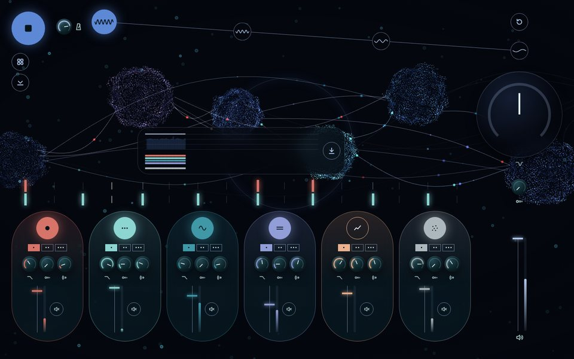

# Нейросинт

Браузерный грувбокс на Tone.js и Three.js: шесть лупов, четыре части сета, 3D-визуализация звука.


## Запуск

Демо: https://digitalsecretaryalex-prog.github.io/WebsintAlex/

Сборки нет. Нужен локальный сервер и доступ к CDN.

```bash
git clone https://github.com/digitalsecretaryalex-prog/WebsintAlex.git
cd WebsintAlex
python3 -m http.server 8000
```

Открыть http://localhost:8000 и нажать круглую кнопку слева сверху.

Под кнопкой старта две кнопки: «Варианты» раскрывает три ряда (виды нейронов, фон, идеи), вторая прячет панель (`H`), чтобы смотреть на нейроны. У каждой кнопки подсказка по наведению. Выбор хранится в адресе:

- `?view=flight|stream|field|cascade`: вид нейронов, без параметра `field`
- `?bg=dust|calcium|tracts`: фон
- `?ideas=breath,prune,trace`: включённые идеи

Шесть капсул равной ширины, ряд кончается по краю растра. Сброс, часть 4, кольцо DJ-фильтра и громкость стоят на одной вертикали. Колонка выхода шириной с кольцо, поэтому поля слева и справа равны.

## Управление

| | Мышь | Клавиши |
| --- | --- | --- |
| Старт / стоп | кнопка слева сверху | `Space` |
| Слой | кнопка слоя | `1`-`6` |
| Вариация | точки под кнопкой | `Q` `W` `E` `R` `T` `Y` |
| Часть сета | кнопки сверху | `Z` `X` `C` `V` |
| Сброс части | круг справа сверху | `0` |
| Скрыть панель | кнопка под «Вариантами» | `H` |
| Ракурс | тянуть по фону, правая кнопка или Shift сдвигает, колесо приближает | |
| Ручки и движки | drag, двойной клик для сброса | стрелки, `PageUp`, `PageDown`, `Home`, `End` |

Смены слоёв и частей применяются с начала следующего такта.

| Часть | BPM | Слои |
| --- | --- | --- |
| 1 | 84 | бочка, перкуссия, бас, пэд, фон |
| 2 | 79 | + мелодия |
| 3 | 74 | без бочки, фильтр −25 % |
| 4 | 70 | без перкуссии, фильтр −45 %, мастер −3 дБ |

## Виды нейронов

Четыре вида, в каждом нейрон из нейрон из 3 600 мягких точек. По оболочке текут холмы шума в две октавы (simplex), цвет идёт от тёмного синего во впадинах к ледяному на вершинах. Все шары связаны изогнутыми линиями, по каждой линии бежит свой импульс. Нота слоя зажигает шар этого слоя и пускает сигналы его цвета ко всем соседям. Всё плывёт вправо.

| | |
| --- | --- |
|  |  |
|  |  |

- `flight`: шары выплывают из глубины, проходят мимо камеры и рождаются снова вдали. Линии только между ближними.
- `stream`: шары на разной глубине плывут вправо, дальние медленнее, у края тают и выходят слева.
- `field`: два ряда шаров медленно дрейфуют вправо, дышат, вспыхивают по слоям.
- `cascade`: сигнал, дошедший до соседа, зажигает его с вероятностью 0.7, 0.49, 0.34…: нейронная лавина до четырёх шагов.

Когда панель скрыта, нижний ряд шаров плавно опускается на освободившееся место.

Общая модель спайков (`src/views/spikes.js`): рефрактерный период, затухание, редкая фоновая активность.

| Синтезатор | Визуализация |
| --- | --- |
| нота слоя | спайк цвета слоя: импульс по сети или вспышка шара и сигналы к соседям |
| уровень слоя (Tone.Meter) | яркость популяции |
| Mute, выключенный слой | популяция гаснет |
| темп | скорость импульсов, дыхания и полёта |
| простор (реверб) | время затухания спайка |
| DJ-фильтр закрыт | меньше видимых точек и связей, тусклее |
| часть сета 1 → 4 | меньше насыщенности, плотности и энергии |
| уровень мастера | энергия: амплитуда волн и вращения |
| курсор | раздвигает точки шаров; мышь крутит, двигает и приближает вид |

Один WebGL-рендерер на все виды, pixel ratio не больше 2, на скрытой вкладке кадры не рисуются, при смене вида геометрии и материалы освобождаются. При `prefers-reduced-motion` спайков нет, движение медленное.

## Фоны

Фон рисуется отдельной сценой той же камерой до вида, поэтому меняется без пересоздания нейронов (`src/views/background.js`). Яркость фона падает вместе с насыщенностью сета.

- `dust`: 5 000 мелких мерцающих точек, как звёзды в глубине.
- `calcium`: 2 400 клеток-колец, каждая вспыхивает и медленно гаснет в своём ритме, как на кальциевой съёмке нейронов. К концу сета вспышки реже.
- `tracts`: 320 волокон белого вещества, цвет по направлению, как на картах трактов; по каждому бежит волна.

| | |
| --- | --- |
|  |  |

## Идеи

Четыре кнопки в последнем ряду «Вариантов». Первые три усиливают высказывание сета, последняя оставляет след сыгранного сета.

| Идея | Что делает | Где в коде |
| --- | --- | --- |
| Дыхание | круг в центре расширяется на вдохе и сжимается на выдохе; цикл в тактах из части сета: 2, 2, 3, 3 такта, это около 10 вдохов в минуту в части 1 и около 6 в части 4. Шары дышат вместе с кругом | `breath.js`, `parts[].breathBars` |
| Угасание связей | к части 4 между шарами остаётся пятая часть связей: перекличка нейронов стихает вместе с музыкой | `views/swarm.js`, `PART_LOOK.links` |
| Партитура | сет «Спуск» играет сам: 64 такта, 4 части по 16, смены вариаций внутри частей, в конце уходят мелодия и бас. Кольцо на кнопке показывает, сколько сыграно. Руками можно вмешаться, стоп снимает партитуру | `score.js`, `settings.js: score` |
| Гипнограмма | ступеньки частей во времени, громкость и полосы слоёв, как запись сна; сохраняется в PNG | `trace.js` |



## Архитектура

```
source → Filter → FeedbackDelay → Reverb → Channel ─┐ ×6
                                                    └→ lowpass → highpass → FeedbackDelay → Volume → Channel → Limiter → out
```

```
src/
  settings.js   данные: слои, вариации, части, партитура, мастер, клавиши
  audio.js      звуковой граф, транспорт и запись, без DOM
  controls.js   ручка, движок, кнопки, растр, переключатели
  visuals.js    рендерер, фон и вид, сглаженное состояние музыки
  views/        swarm.js (шары), spikes.js (модель спайков),
                background.js (фоны)
  ideas.js      кнопки идей и их связь с инструментом
  breath.js     круг дыхания
  score.js      автопилот партитуры
  trace.js      гипнограмма
  icons.js      SVG-значки
  main.js       точка входа
styles/
  reset.css
  bold/         раскладка по блокам, Ideas.css: идеи
```

- Квантование по такту считается в тиках транспорта: `'@1m'` считает в секундах и после плавной смены темпа промахивается.
- Подсветка нот идёт через `Tone.getDraw()`, поэтому картинка совпадает со звуком.
- Все контролы доступны с клавиатуры, у каждого `aria-label` со значением. При `prefers-reduced-motion` нейроны движутся в 7 раз медленнее, спайки от нот не вспыхивают, переходы частей без анимации.

## Стек

HTML, CSS, JavaScript (ES-модули), [Tone.js](https://tonejs.github.io/) 15.1.22, [Three.js](https://threejs.org/) 0.160.0, Prettier.

## Лицензия

[MIT](LICENSE)
