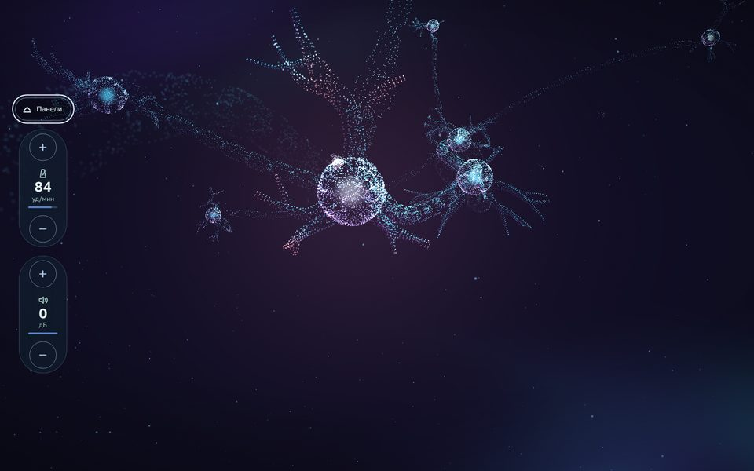
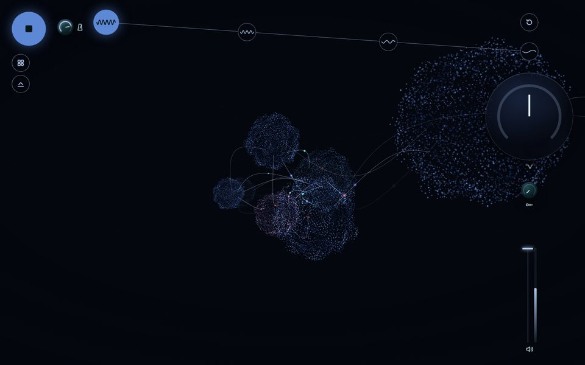
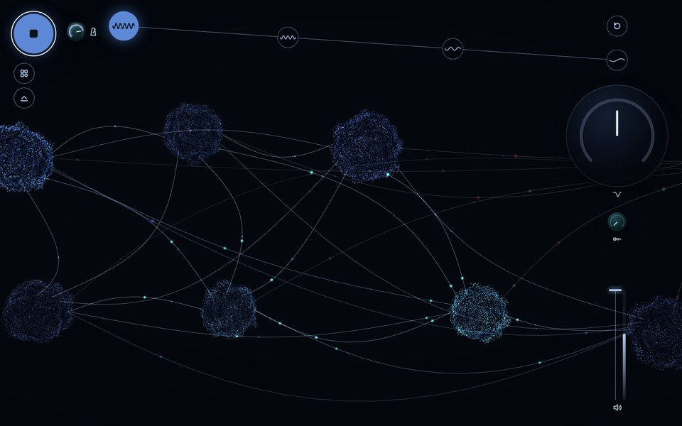
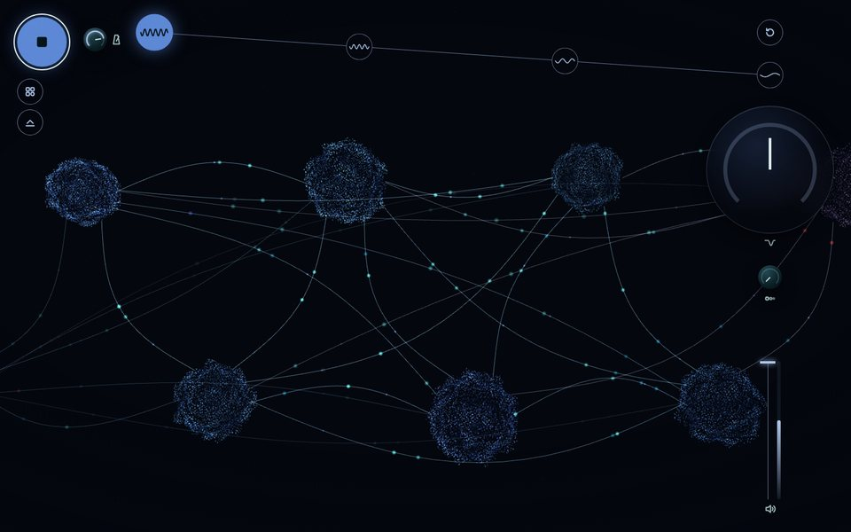
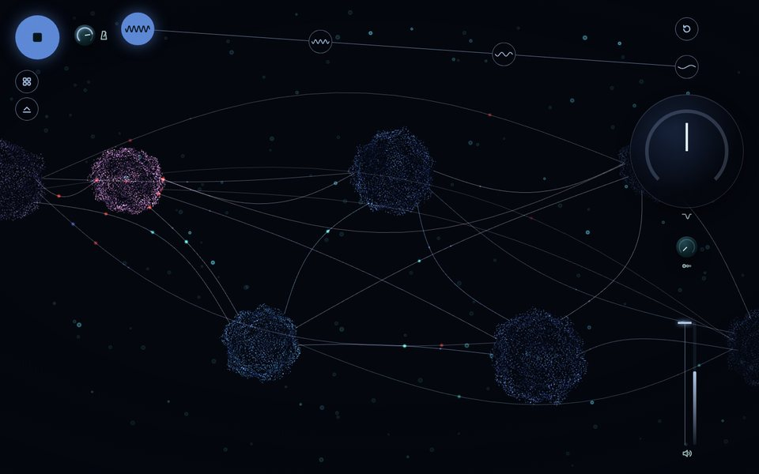
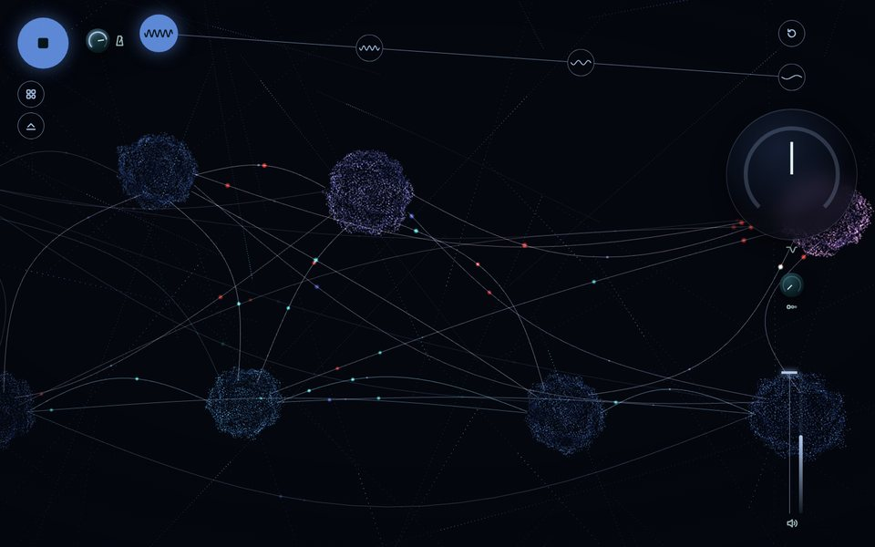
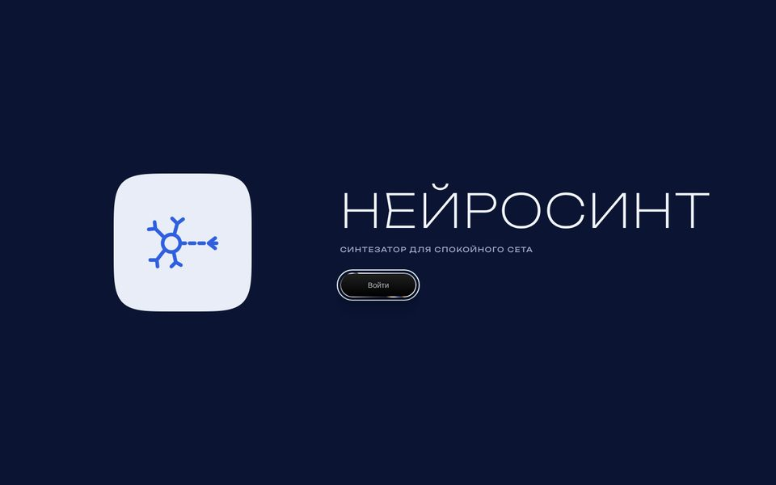
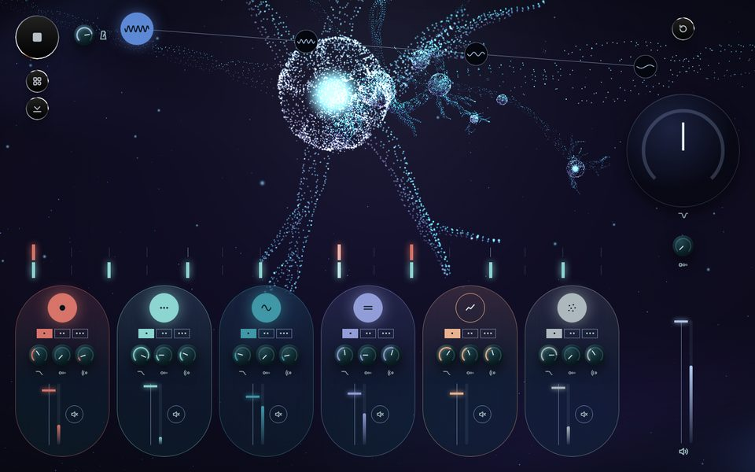

# Нейросинт

Браузерный грувбокс на Tone.js и Three.js: шесть лупов, четыре части сета, 3D-визуализация звука.


## Запуск

Демо: https://digitalsecretaryalex-prog.github.io/WebsintAlex/

Сборки нет. Нужен локальный сервер и доступ к CDN.

```bash
git clone https://github.com/digitalsecretaryalex-prog/WebsintAlex.git
cd WebsintAlex
python3 -m http.server 8000
```

Открыть http://localhost:8000. Сначала заставка: стеклянная плитка со знаком и кнопка «Войти» (`Esc` тоже закрывает). Звук она не запускает. Потом круглая кнопка слева сверху.

Под кнопкой старта две кнопки: «Варианты» раскрывает три ряда (виды нейронов, фон, вид пульта), вторая прячет панели (`H`), чтобы смотреть на нейроны. Обе стоят на оси кнопки старта. У каждой кнопки подсказка по наведению. Выбор хранится в адресе:

- `?view=flight|stream|field|cascade|tunnel|wave`: вид нейронов, без параметра `field`
- `?bg=dust|calcium|tracts`: фон, во всех видах
- `?ui=metal|glass|liquid`: вид пульта, без параметра обычный (ниже)
- `?intro=0`: без заставки

Шесть капсул равной ширины, ряд кончается по краю растра. Сброс, часть 4, кольцо DJ-фильтра и громкость стоят на одной вертикали. Колонка выхода шириной с кольцо, поэтому поля слева и справа равны.

## Управление

|  | Мышь | Клавиши |
| --- | --- | --- |
| Старт / стоп | кнопка слева сверху | `Space` |
| Слой | кнопка слоя | `1`-`6` |
| Вариация | точки под кнопкой | `Q` `W` `E` `R` `T` `Y` |
| Часть сета | кнопки сверху | `Z` `X` `C` `V` |
| Сброс части | круг справа сверху | `0` |
| Скрыть панели | кнопка под «Вариантами», вернуть: «Панели» слева | `H` |
| Ракурс | тянуть по фону, правая кнопка или Shift сдвигает, колесо приближает |  |
| Ручки и движки | drag, двойной клик для сброса | стрелки, `PageUp`, `PageDown`, `Home`, `End` |
| Панорама слоя, свинг | только в `?ui=glass` и `?ui=liquid`: четвёртая ручка капсулы и ручка рядом с темпом | как у ручек |

Смены слоёв и частей применяются с начала следующего такта.

Когда панели скрыты, на экране только нейроны и слева два регулятора: темп по 1 уд/мин (части сета отличаются на 4–5) и общая громкость по 2 дБ. Клик даёт один шаг, удержание повторяет шаг, стрелки на значении тоже шагают, `PageUp` и `PageDown` по пять шагов. Значения те же, что у крутилки темпа и движка выхода.



| Часть | BPM | Слои                                      |
| ----- | --- | ----------------------------------------- |
| 1     | 84  | бочка, перкуссия, бас, пэд, фон           |
| 2     | 79  | + мелодия                                 |
| 3     | 74  | без бочки, фильтр −25 %                   |
| 4     | 70  | без перкуссии, фильтр −45 %, мастер −3 дБ |

## Виды нейронов

До звука сеть спит во всех видах: шары и камера стоят, свет медленно дышит. Просыпается не по клику, а когда звук реально пошёл (`audio.isSounding()`: транспорт запущен и аудиоконтекст работает). После стопа движение плавно затихает, сцена не сбрасывается.

### Цепь: тоннель и волна

Два вида собраны из приёмов двух эталонных сцен Three.js (Tunnel и Flow Wave). Сцены взяты не целиком: из каждой взят способ рисовать точками, цвет и фон, и этим способом нарисованы нейроны. Поведение у обоих видов общее (`src/views/chain.js`):

- нейроны стоят цепью на изогнутом пути; импульс проходит один пролёт за такт и доходит до следующего нейрона перед сильной долей: волна бежит по дендритам к телу, тело вспыхивает цветом слоя;
- нейрон впереди рождается по мере приближения камеры;
- камера держится позади импульса и мягко его догоняет;
- на периферии живут нейроны слоёв: нота зажигает нейрон своего слоя, его сигнал бежит по аксону к цепи;
- форма дендритов общая (`src/views/skeleton.js`): звёздчатые нейроны и каждый третий пирамидный.

|                                  |                              |
| -------------------------------- | ---------------------------- |
|  |  |

- `tunnel`: приём сцены Tunnel. Точки на кольцах трубы, шум в две октавы рябит радиус, угол дрожит и закручивается, цвет от индиго к циану. Тело нейрона: воронка из колец, сужается в аксон. Аксон: тонкий тоннель с перехватами миелина, импульс раздувает кольца. Нейрон рождается из вихря.
- `wave`: приём сцены Flow Wave. Ровная сетка точек читается пунктирными линиями, по ней катятся холмы шума, цвет от изумрудного к мятному на гребнях. Тело: мембрана-сфера, по ней от дендритов к аксону катятся холмы, вспышка расходится кругами. Дендриты и аксон: ленты из той же сетки, импульс катится по ленте валом с рябью. Нейрон рождается из плоского листа точек. Во сне камера висит высоко, со звуком ныряет к ленте аксона, после стопа поднимается.

#### Свет под звук

Каждая нота каждого слоя приходит в вид отдельным событием с громкостью, высотой и длиной (`audio.js: notify` → `chain.pulse`). У слоя свой рисунок света, поэтому по картинке слышно, кто играет:

| Слой | Что вспыхивает |
| --- | --- |
| бочка | всё тело и дендриты толкаются от удара, камера на миг подаётся вперёд, фон светлеет; в волне от тела расходится кольцо |
| перкуссия | искры на кончиках дендритов, на каждый удар новый узор; акцент ярче |
| бас | аксон светится цветом баса, пока нота звучит |
| пэд | тело наливается цветом аккорда, фон окрашивается в цвет пэда |
| мелодия | пакет бежит по одному дендриту к телу за полдлины ноты; какой дендрит, решает высота ноты |
| фон | пылинки вокруг цепи вспыхивают по одной на каждый щелчок |

Ручки слоя тоже видны в свете: закрытый фильтр даёт тусклую вспышку, эхо повторяет её через пунктирную восьмую (как `FeedbackDelay`), простор (реверб) удлиняет хвост, панорама зажигает нейрон слева или справа от цепи, Mute гасит слой.

Свет ждёт ноту ровно столько, сколько звук идёт до колонок: время ноты плюс `baseLatency` и `outputLatency` аудиоконтекста. В headless Chrome это 23 + 72 мс, и свет приходит в первый кадр после этого. Живая частота кадров на видеокарте и совпадение на слух не проверены.

Отличия от эталонов: вместо скролла сцену ведут звук и темп; три композера постобработки заменены одним проходом фона, потому что текстуры bloom в эталонах чёрные (слои камеры их не заполняют, проверено чтением пикселей); значения, цвета, шейдер фона и пылинки взяты из эталонов. Точные копии эталонов лежат отдельно от инструмента.

### Шары

Четыре вида, в каждом нейрон из 3 600 мягких точек. По оболочке текут холмы шума в две октавы (simplex), цвет идёт от тёмного синего во впадинах к ледяному на вершинах. Все шары связаны изогнутыми линиями, по каждой линии бежит свой импульс. Нота слоя зажигает шар этого слоя и пускает сигналы его цвета ко всем соседям. Всё плывёт вправо.

|                                |                                  |
| ------------------------------ | -------------------------------- |
|  |    |
|    |  |

- `flight`: шары выплывают из глубины, проходят мимо камеры и рождаются снова вдали. Линии только между ближними.
- `stream`: шары на разной глубине плывут вправо, дальние медленнее, у края тают и выходят слева.
- `field`: два ряда шаров медленно дрейфуют вправо, дышат, вспыхивают по слоям.
- `cascade`: сигнал, дошедший до соседа, зажигает его с вероятностью 0.7, 0.49, 0.34…: нейронная лавина до четырёх шагов.

Когда панель скрыта, нижний ряд шаров плавно опускается на освободившееся место.

Общая модель спайков (`src/views/spikes.js`): рефрактерный период, затухание, редкая фоновая активность.

| Синтезатор | Визуализация |
| --- | --- |
| нота слоя | спайк цвета слоя: импульс по сети или вспышка шара и сигналы к соседям |
| уровень слоя (Tone.Meter) | яркость популяции |
| Mute, выключенный слой | популяция гаснет |
| темп | скорость импульсов, дыхания и полёта |
| простор (реверб) | время затухания спайка |
| DJ-фильтр закрыт | меньше видимых точек и связей, тусклее |
| часть сета 1 → 4 | меньше насыщенности, плотности и энергии |
| уровень мастера | энергия: амплитуда волн и вращения |
| курсор | раздвигает точки шаров; мышь крутит, двигает и приближает вид |

Один WebGL-рендерер на все виды, pixel ratio не больше 2, на скрытой вкладке кадры не рисуются, при смене вида геометрии и материалы освобождаются. При `prefers-reduced-motion` спайков нет, движение медленное; в цепи камера стоит, а на каждый такт мягко светится один из ближних нейронов, сон и пробуждение видны по яркости.

## Фоны

Фон рисуется отдельной сценой той же камерой до вида, поэтому меняется без пересоздания нейронов (`src/views/background.js`). Яркость фона падает вместе с насыщенностью сета.

У `tunnel` и `wave` под фоном лежит подложка эталона (цвет и всполохи): порядок «подложка → фон → нейроны». Там фон идёт за камерой, как звёзды, иначе цепь улетела бы из него, и светит вдвое ярче, чтобы не теряться на подложке.

- `dust`: 5 000 мелких мерцающих точек, как звёзды в глубине.
- `calcium`: 2 400 клеток-колец, каждая вспыхивает и медленно гаснет в своём ритме, как на кальциевой съёмке нейронов. К концу сета вспышки реже.
- `tracts`: 320 волокон белого вещества, цвет по направлению, как на картах трактов; по каждому бежит волна.

|                                 |                               |
| ------------------------------- | ----------------------------- |
|  |  |

## Заставка и металл

Заставка и вариант `?ui=metal` используют два компонента 21st.dev, перенесённые с React на обычный JS:

- `src/glass.js`: liquid-glass-logo-reveal. Шейдер и пружинная анимация без изменений (в исходнике они перенесены из [zanwei/glass-icon-reveal](https://github.com/zanwei/glass-icon-reveal), MIT). Вместо логотипа 21st.dev знак-заглушка: нейрон линиями в духе значков инструмента. Стекло оседает светлой плиткой на тёмно-синем фоне.
- `src/metal.js`: liquid-metal-button. Шейдер из [@paper-design/shaders](https://github.com/paper-design/shaders) (Apache-2.0), параметры из компонента: металл течёт медленно, под курсором быстрее, на нажатие ускоряется на 300 мс, от клика расходится круг. Металл надевается на существующие кнопки (старт, сброс, варианты, панели, «Панели»), их подписи, клавиши и обработчики не меняются. Подпись светлее, чем в исходнике, ради контраста; фокус виден.

|                             |                           |
| --------------------------- | ------------------------- |
|  |  |

## Вид пульта

Третий ряд «Вариантов» переключает вид пульта на ходу, музыка не останавливается: обычный, металл (`?ui=metal`), стекло (`?ui=glass`), жидкий металл (`?ui=liquid`). Прошлый вид снимается целиком: каждая функция, которая надевает металл, возвращает функцию, которая его снимает (`applyUi` в `main.js`).

Стекло и жидкий металл: два варианта всего пульта в материалах заставки. Раскладка, клавиши и звук те же, что в обычном виде.

- `?ui=glass`: светлые стеклянные плитки на тёмно-синем фоне, как плитка заставки. Капсулы слоёв со стеклянным бликом и радужной кромкой в углах, ручки стеклянными куполами, кнопки в металлических кольцах с синим значком. По умолчанию вид `tunnel`.
- `?ui=liquid`: чёрное железо. Жидкий металл на каждой ручке и кнопке (71 элемент), цвет слоя только в светодиодах: полоска над капсулой, шкала ручки, нажатый шаг, лесенка уровня. По умолчанию вид `wave`.

Что добавлено в обоих вариантах:

- ручка панорамы у каждого слоя (4-я в капсуле) и ручка свинга рядом с темпом (`Transport.swing`, сдвиг каждой второй шестнадцатой, до 50 %);
- значение под каждой ручкой: «900 Гц», «8 %», «Л 15», «центр»;
- 11 рисок вокруг ручки на её ходе 270°, у большого кольца DJ-фильтра 21 риска;
- шкала из 11 рисок у каждого движка, хромовая ручка движка;
- уровень слоя лесенкой светодиодов, тёмные ячейки видны всегда.

|                           |                                   |
| ------------------------- | --------------------------------- |
|  |  |

Металл на всех элементах рисует один WebGL-контекст (`src/liquid.js`): тот же шейдер, что у кнопок `?ui=metal`, считается на скрытом холсте в две плитки, круг и капсулу, 24 кадра в секунду. Каждый элемент копирует плитку в свой маленький холст, повернув на свой угол, чтобы металл не повторялся. По контексту на кнопку не выйдет: браузер держит около 16 контекстов. Со звуком металл течёт быстрее, при `prefers-reduced-motion` стоит. Без WebGL2 или без сети кольцо рисует CSS-градиент.

## Архитектура

```
source → Filter → FeedbackDelay → Reverb → Channel ─┐ ×6
                                                    └→ lowpass → highpass → FeedbackDelay → Volume → Channel → Limiter → out
```

```
src/
  settings.js   данные: слои, вариации, части, мастер, клавиши
  audio.js      звуковой граф и транспорт, без DOM
  controls.js   ручка, движок, кнопки, растр, переключатели
  visuals.js    рендерер, фон и вид, сглаженное состояние музыки, сон
  views/        swarm.js (шары), spikes.js (модель спайков),
                background.js (фоны), chain.js (цепь нейронов),
                skeleton.js (форма дендритов), tunnel.js, wave.js
                (стили цепи), atmosphere.js (фон и пылинки эталонов)
  intro.js      заставка
  glass.js      стеклянное появление знака
  metal.js      жидкий металл для кнопок
  liquid.js     жидкий металл на всех элементах одним контекстом
  icons.js      SVG-значки
  main.js       точка входа
styles/
  reset.css
  bold/         раскладка по блокам, MiniConsole.css: скрытые панели,
                Intro.css, Metal.css,
                Skin.css: общее для стекла и жидкого металла
  glass/        Glass.css: цвета и материал варианта ?ui=glass
  liquid/       Liquid.css: цвета и материал варианта ?ui=liquid
```

- Квантование по такту считается в тиках транспорта: `'@1m'` считает в секундах и после плавной смены темпа промахивается.
- Подсветка нот идёт через `Tone.getDraw()`, поэтому картинка совпадает со звуком.
- Хрип в звуке убран: пэд был на `pwm`, а этот осциллятор Tone строит на WaveShaper и даёт алиасинг (негармонические призвуки около −35 дБ), теперь `fatsawtooth` из трёх голосов; треск фона тише; контекст с `latencyHint: 'playback'` и `lookAhead` 0.15 с, буфер больше, звук не рвётся под нагрузкой 3D. Лимитер не срабатывает: пики выхода ниже −3.7 дБ.
- Звук не зависит от визуала: Three.js и шейдеры грузятся отдельно, без сети инструмент звучит.
- Все контролы доступны с клавиатуры, у каждого `aria-label` со значением. При `prefers-reduced-motion` нейроны движутся в 7 раз медленнее, спайки от нот не вспыхивают, переходы частей без анимации.

## Стек

HTML, CSS, JavaScript (ES-модули), [Tone.js](https://tonejs.github.io/) 15.1.22, [Three.js](https://threejs.org/) 0.160.0, [@paper-design/shaders](https://www.npmjs.com/package/@paper-design/shaders) 0.0.81 (только металл), Prettier. Шрифты Golos Text и Unbounded из Google Fonts.

## Лицензия

[MIT](LICENSE)
