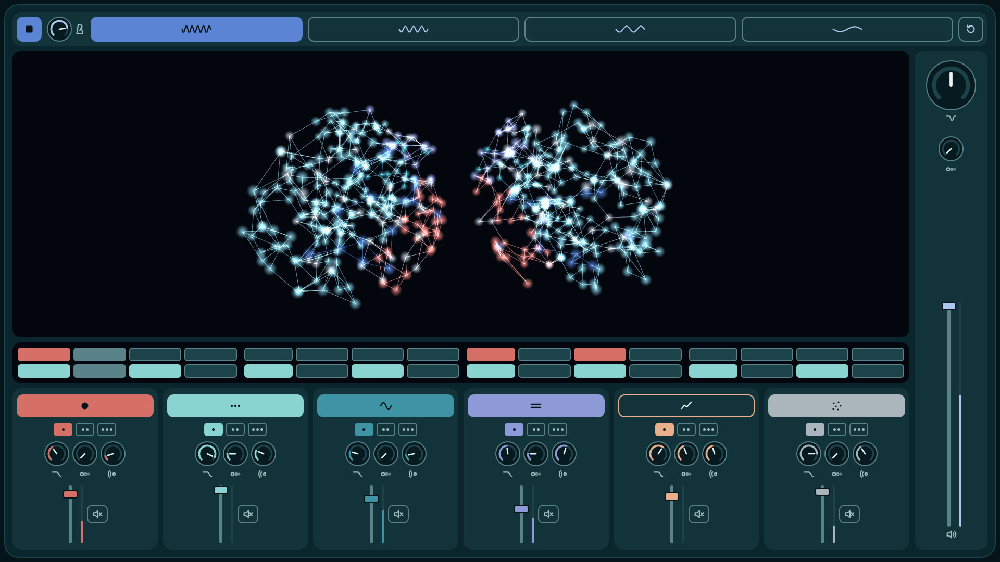

# Нейросинт

Браузерный грувбокс на Tone.js и Three.js: шесть лупов, четыре части сета, 3D-визуализация звука.


## Запуск

Демо: https://digitalsecretaryalex-prog.github.io/WebsintAlex/

Сборки нет. Нужен локальный сервер и доступ к CDN.

```bash
git clone https://github.com/digitalsecretaryalex-prog/WebsintAlex.git
cd WebsintAlex
python3 -m http.server 8000
```

- http://localhost:8000: основная раскладка
- http://localhost:8000/classic.html: классическая раскладка



## Управление

| | Мышь | Клавиши |
| --- | --- | --- |
| Старт / стоп | кнопка слева сверху | `Space` |
| Слой | кнопка слоя | `1`-`6` |
| Вариация | точки под кнопкой | `Q` `W` `E` `R` `T` `Y` |
| Часть сета | кнопки сверху | `Z` `X` `C` `V` |
| Сброс части | ромб справа сверху | `0` |
| Ручки и движки | drag, двойной клик для сброса | стрелки, `PageUp`, `PageDown`, `Home`, `End` |

Смены слоёв и частей применяются с начала следующего такта.

| Часть | BPM | Слои |
| --- | --- | --- |
| 1 | 84 | бочка, перкуссия, бас, пэд, фон |
| 2 | 79 | + мелодия |
| 3 | 74 | без бочки, фильтр −25 % |
| 4 | 70 | без перкуссии, фильтр −45 %, мастер −3 дБ |

## Архитектура

```
source → Filter → FeedbackDelay → Reverb → Channel ─┐ ×6
                                                    └→ lowpass → highpass → FeedbackDelay → Volume → Channel → Limiter → out
```

```
src/
  settings.js   данные: слои, вариации, части, мастер, клавиши
  audio.js      звуковой граф и транспорт, без DOM
  controls.js   ручка, движок, кнопки, растр
  brain3d.js    3D-сеть, только читает состояние музыки
  icons.js      SVG-значки
  main.js       точка входа
styles/
  reset.css
  bold/         основная раскладка
  classic/      классическая раскладка
```

- Квантование по такту считается в тиках транспорта: `'@1m'` считает в секундах и после плавной смены темпа промахивается.
- Подсветка нот идёт через `Tone.getDraw()`, поэтому картинка совпадает со звуком.
- Все контролы доступны с клавиатуры, у каждого `aria-label` со значением. При `prefers-reduced-motion` сеть не вращается.

## Стек

HTML, CSS, JavaScript (ES-модули), [Tone.js](https://tonejs.github.io/) 15.1.22, [Three.js](https://threejs.org/) 0.160.0, Prettier.

## Лицензия

[MIT](LICENSE)
