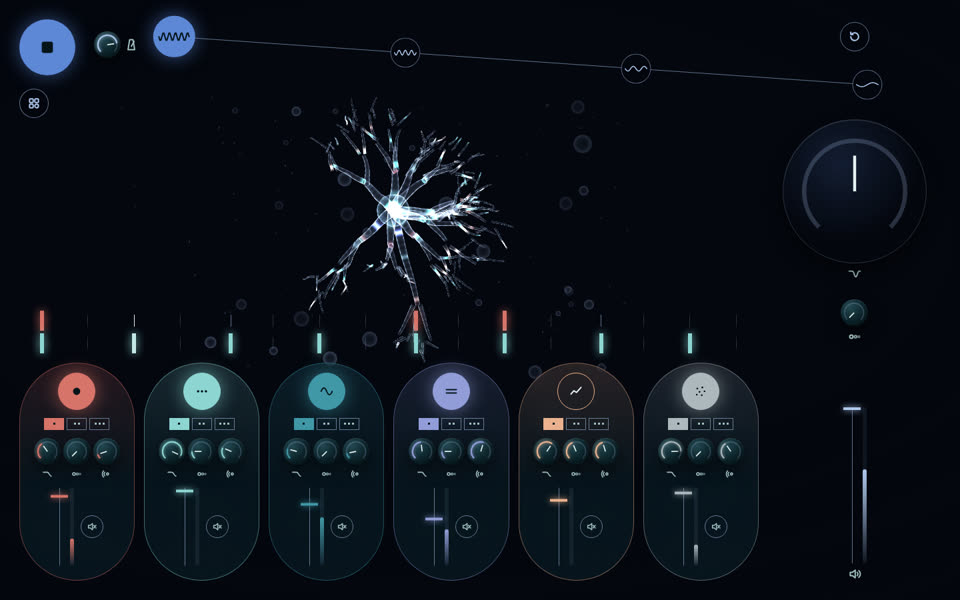
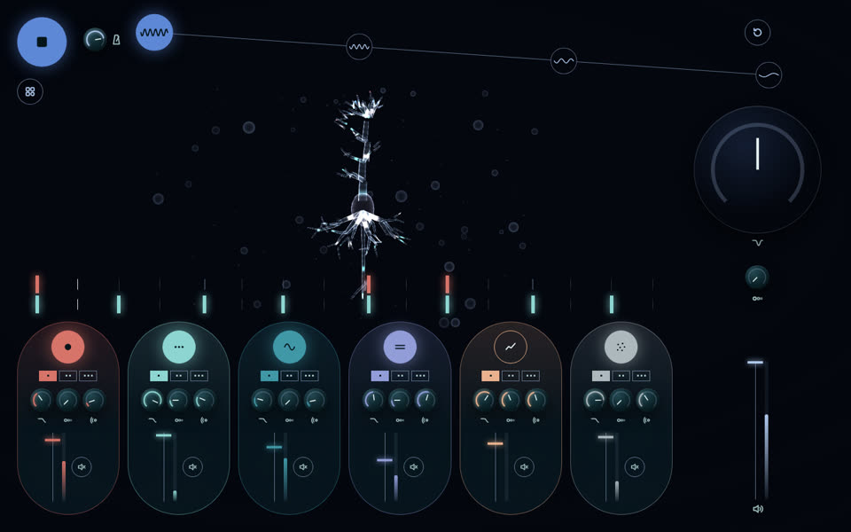
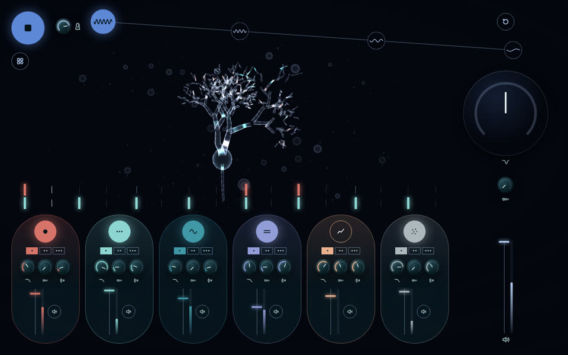
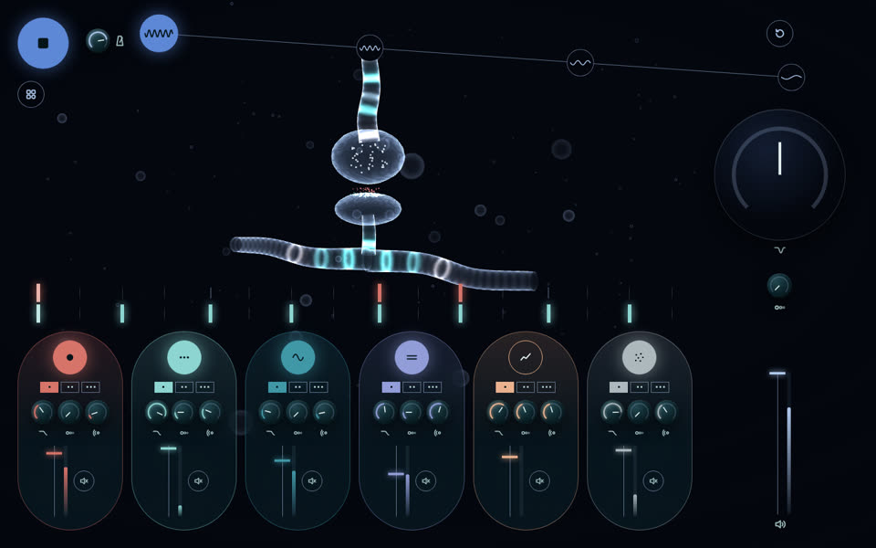
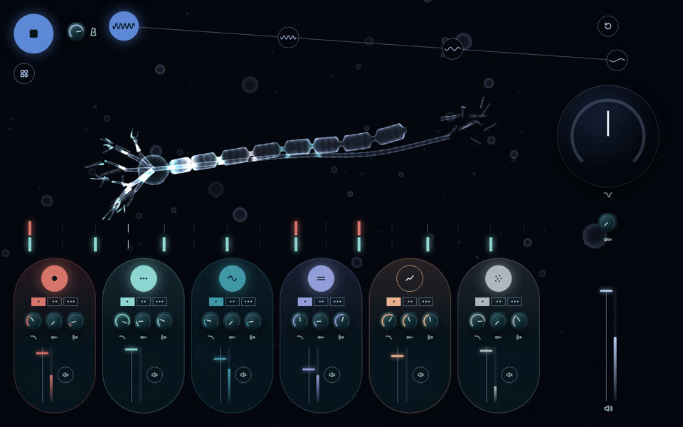
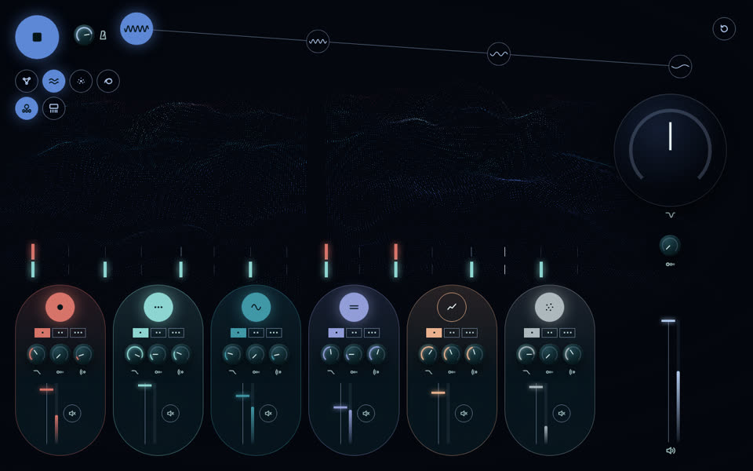
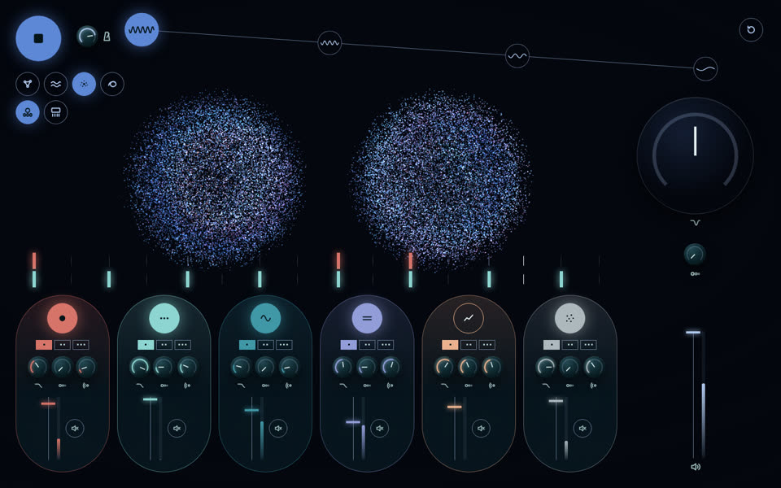
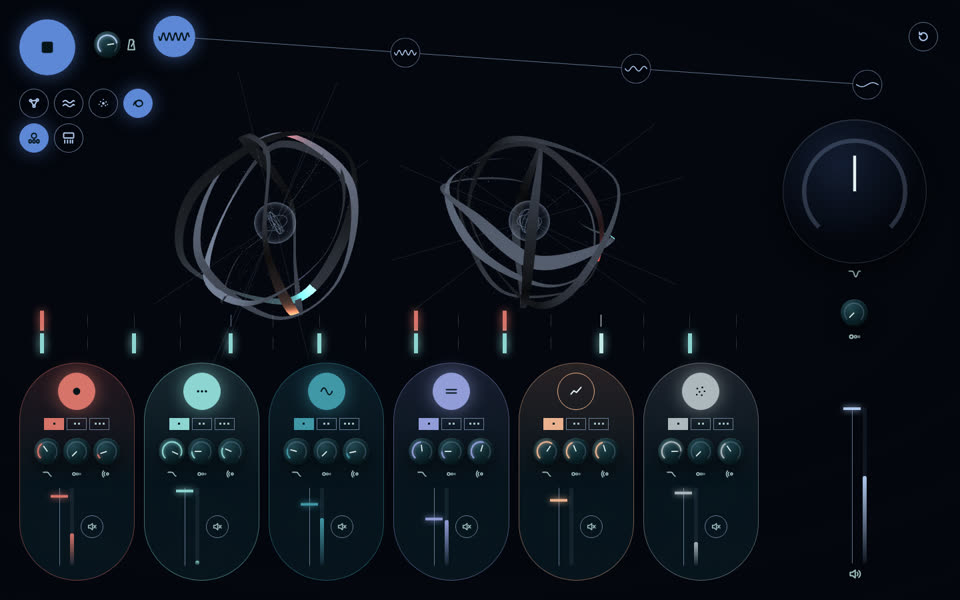

# Нейросинт

Браузерный грувбокс на Tone.js и Three.js: шесть лупов, четыре части сета, 3D-визуализация звука.


## Запуск

Демо: https://digitalsecretaryalex-prog.github.io/WebsintAlex/

Сборки нет. Нужен локальный сервер и доступ к CDN.

```bash
git clone https://github.com/digitalsecretaryalex-prog/WebsintAlex.git
cd WebsintAlex
python3 -m http.server 8000
```

Открыть http://localhost:8000 и нажать круглую кнопку слева сверху.

Под кнопкой старта кнопка «Варианты»: раскрывает виды нейронов и варианты нижней панели. Выбор хранится в адресе:

- `?view=…`: вид нейронов, список ниже
- `?layout=a|b|c`: вариант нижней панели, без параметра исходная
  - `a`: раскрыт только выбранный канал, остальные показывают кнопку, фейдер и Mute
  - `b`: шесть узких полос и один инспектор выбранного канала
  - `c`: компактные капсулы, вариации и ручки всплывают над капсулой по наведению, фокусу или кнопке

Любой параметр канала доступен за одно действие: выбор канала (`a`, `b`) или раскрытие (`c`).

| `a` | `b` | `c` |
| --- | --- | --- |
|  |  |  |

## Управление

| | Мышь | Клавиши |
| --- | --- | --- |
| Старт / стоп | кнопка слева сверху | `Space` |
| Слой | кнопка слоя | `1`-`6` |
| Вариация | точки под кнопкой | `Q` `W` `E` `R` `T` `Y` |
| Часть сета | кнопки сверху | `Z` `X` `C` `V` |
| Сброс части | круг справа сверху | `0` |
| Ручки и движки | drag, двойной клик для сброса | стрелки, `PageUp`, `PageDown`, `Home`, `End` |

Смены слоёв и частей применяются с начала следующего такта.

| Часть | BPM | Слои |
| --- | --- | --- |
| 1 | 84 | бочка, перкуссия, бас, пэд, фон |
| 2 | 79 | + мелодия |
| 3 | 74 | без бочки, фильтр −25 % |
| 4 | 70 | без перкуссии, фильтр −45 %, мастер −3 дБ |

## Виды нейронов

Клетки: стеклянная мембрана, сигналы бегут по ветвям, на фоне боке.

| | |
| --- | --- |
|  |  |
|  |  |
|  | |

- `multipolar`: мультиполярный нейрон, звезда ветвящихся дендритов и длинный аксон.
- `pyramidal`: пирамидный нейрон коры, апикальный ствол с пучком наверху, базальные дендриты внизу.
- `purkinje`: клетка Пуркинье мозжечка, плоский густой веер дендритов.
- `synapse`: сигнал спускается в бутон, медиатор пересекает щель, дальше сигнал идёт по дендриту.
- `axon`: миелиновый аксон, сигнал перескакивает от перехвата к перехвату.

Поля и облака:

| | |
| --- | --- |
|  |  |
|  | |

- `network`: 520 нейронов в двух полушариях, импульсы по связям.
- `flow`: поле точек как кора, волны активности бегут по Simplex-шуму, полушария со сдвигом фазы.
- `storm`: два облака по 18 000 точек, популяция дышит, спайки расходятся от центра.
- `ink`: ленты-аксоны по орбитам вокруг стеклянной сферы, сигнал бежит по ленте своего слоя.

Общая модель спайков (`src/views/spikes.js`): вспышка, волна по полушарию, затухание, рефрактерный период 0,14 с, редкая фоновая активность.

| Синтезатор | Визуализация |
| --- | --- |
| нота слоя | спайк цвета слоя: волна по полушарию или сигнал по ветвям клетки |
| уровень слоя (Tone.Meter) | яркость популяции |
| Mute, выключенный слой | популяция гаснет |
| темп | скорость волны, дыхания, течения |
| простор (реверб) | время затухания спайка |
| DJ-фильтр закрыт | меньше видимых точек и связей, тусклее |
| часть сета 1 → 4 | меньше насыщенности, плотности и энергии |
| уровень мастера | энергия: амплитуда волн и вращения |
| курсор | раздвигает точки (`flow`, `storm`), мышь крутит сцену |

Один WebGL-рендерер на все виды, pixel ratio не больше 2, на скрытой вкладке кадры не рисуются, при смене вида геометрии и материалы освобождаются. При `prefers-reduced-motion` спайков нет, движение медленное.

## Архитектура

```
source → Filter → FeedbackDelay → Reverb → Channel ─┐ ×6
                                                    └→ lowpass → highpass → FeedbackDelay → Volume → Channel → Limiter → out
```

```
src/
  settings.js   данные: слои, вариации, части, мастер, клавиши
  audio.js      звуковой граф и транспорт, без DOM
  controls.js   ручка, движок, кнопки, растр
  visuals.js    рендерер, переключение видов, сглаженное состояние музыки
  views/        виды нейронов, модель спайков, общие детали клеток, шум
  icons.js      SVG-значки
  main.js       точка входа
styles/
  reset.css
  bold/         раскладка, Panel.css: варианты нижней панели
```

- Квантование по такту считается в тиках транспорта: `'@1m'` считает в секундах и после плавной смены темпа промахивается.
- Подсветка нот идёт через `Tone.getDraw()`, поэтому картинка совпадает со звуком.
- Все контролы доступны с клавиатуры, у каждого `aria-label` со значением. При `prefers-reduced-motion` сеть не вращается, переходы частей без анимации.

## Стек

HTML, CSS, JavaScript (ES-модули), [Tone.js](https://tonejs.github.io/) 15.1.22, [Three.js](https://threejs.org/) 0.160.0, Prettier.

## Лицензия

[MIT](LICENSE)
